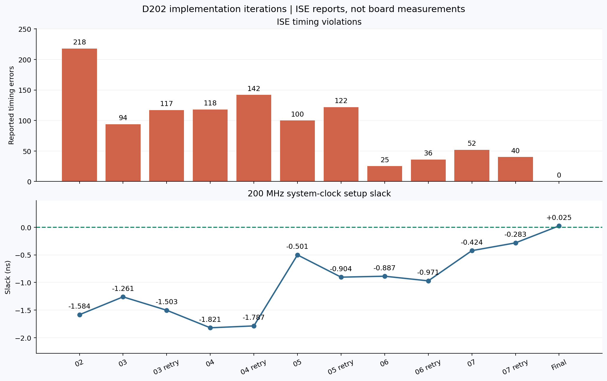

# 2026-10-27 D202 메모리 관리 구현·검증 기록

세 저장소의 `feature/managed-pattern-memory`에서 고정 슬롯 메모리 관리, 실험 재생 기능, API와 검증 harness를 연결했습니다. 최종 구현 수치와 파일 해시는 아래 산출물의 `validation.json`이 기준입니다. D202의 실제 JTAG 구성·DDR2·광학·온도 검증은 아직 수행하지 않았습니다.

## 기능 변화

| 항목 | D201 | D202 |
|---|---|---|
| 패턴 저장 | 연속 라이브러리 전체 전송 | 0..2542 고정 ID별 전송·교체, 다른 슬롯 보존 |
| 삭제 | 개별 관리 없음 | 개별/전체 논리적 무효화, ID 유지 |
| 무결성 | 업로드 완료 플래그 | 실제 DDR readback CRC32, 재검증, 오류 슬롯 차단 |
| 중단된 쓰기 | 개별 슬롯 상태 없음 | writing/error 상태, timeout/abort, 다시 업로드 |
| 시퀀스 검사 | ID 범위 검사 | 전체 참조 슬롯 preflight 및 변경 generation 검사 |
| 실험 저장 | 호스트 재생 설정 | 참조 슬롯 CRC가 결합된 JSON, 내용 변경 시 거부 |
| 완료 동작 | 마지막 이미지 유지 | 마지막 유지 또는 지정 종료 패턴 한 번 출력 |
| 관찰 | 상태·반복 횟수 | snapshot의 MCP 간격·프레임 수·종료 이유, 선택적 GPIO 펄스 |

순서·유한/무한 반복·TTL 시작은 유지합니다. 삭제는 DDR를 0으로 채우거나 DMD를 blank하는 동작이 아닙니다. slot metadata는 FPGA reset/SW2/재구성 시 사라지므로 다시 업로드해야 합니다. 일반 JTAG 구성은 PROM을 변경하지 않습니다.

## 파일 정리

- FPGA 두 테스트의 공통 연결·클럭·frame scoreboard를 `src/sim/harness/playback_harness.vh`로 분리했습니다.
- Test의 `dmd_test/harness.py`가 검증 시나리오를, `memory_cli.py`가 인자·실행 기록을 담당합니다.
- API의 register fixture는 `tests/fixtures/`에 모았습니다. 생산 PS 명령 본문을 이 fixture에서 실행합니다.
- FPGA 루트 README는 현재 실행 순서 중심으로 줄이고, 긴 D201 진단·명령 기록은 `docs/history/`에 링크를 유지하여 보존했습니다.
- 각 저장소에 `docs/README.md`, `docs/TESTING.md`를 두어 시작 안내·명세·검증 기록을 연결했습니다.
- 사용자 `runs/`는 보존하고 Git 추적 대상에서 제외했습니다. TI 참조 파일, 생성 IP, 과거 bitstream은 이동하거나 삭제하지 않았습니다.
- Test에 기존부터 있던 애니메이션 및 stop 관련 미커밋 작업은 보존했으며 이번 커밋에 포함하지 않습니다.

## 자동 검증

커밋 대상 파일을 별도 폴더로 꺼내 wheel을 빌드·설치한 상태에서 API **27개**, Test **12개** 검사가 통과했습니다. 인터넷 다운로드, 새 가상환경, 새 제어 런타임 의존성 없이 기존 Python을 사용했습니다. 사용자 작업을 포함한 원래 작업 폴더에서도 Test **20개**가 통과했습니다. 두 숫자는 테스트 집합이 달라서 차이가 납니다.

`python -S`로 기본 site-packages 로딩을 끄고 설치한 두 wheel만 지정한 상태에서도 `memory selftest --simulate`를 통과했습니다. [실행 로그](../../artifacts/dmd-20261027-d202/tests/stdlib-runtime.log)는 장치에 접근하지 않은 결과입니다.

RTL 검사는 실제 Xilinx FIFO 모델과 지연/역압력이 있는 MIG user-port 모델을 사용합니다. USB 경계·행 내용·임의 순서·반복·TTL·정지, sparse ID 교체·삭제, DDR 데이터 손상 시 CRC 오류, 중단 후 복구, 전체 시퀀스 사전 검사, 종료 패턴, snapshot, 마지막 슬롯 2542를 검사합니다. CRC와 재생이 동시에 FIFO를 읽으면 테스트를 실패시킵니다.

배치·배선 중 sequence RAM → slot RAM, 상태 decode → slot RAM, CRC/재생 FIFO 읽기 경로의 타이밍 위반을 발견했습니다. 주소 조회에 파이프라인을 추가하고, FIFO 시작 단계에서 보장되는 배타 조건을 읽기 경로에서 중복 검사하지 않도록 수정했습니다. UCF 클럭 주기를 완화하거나 생성 IP를 바꾸지 않았습니다. 새 abort 동기화 및 업로드 base 주소에는 기존 CDC 제약 방식을 적용했습니다.

CRC 읽기 요청을 레지스터에 저장해 FIFO enable까지의 경로를 줄였으며, 반복 카운터 초기화와 시작 횟수 갱신은 STARTING 단계에서 수행합니다. CRC는 FIFO를 단독 사용하고 읽기 하나씩을 기다리므로 요청 지연이 프레임 데이터를 누락시키지 않는지 전체 데이터/CRC 회귀 검사로 확인했습니다.

재생기의 행 버퍼 읽기 허용 상태도 별도 레지스터로 분리했습니다. 한 행에 8개 요청을 수락하면 다음 응답을 기다리며, 여덟 응답이 모두 도착하고 다음 bank가 비어 있어야 다시 읽습니다. 행당 요청 수, bank 소유권, 전체 768행 내용은 공통 harness가 검사합니다.

슬롯 valid 판단, 디렉터리 busy 출력, CRC 비교 결과도 레지스터로 분리했습니다. busy는 FSM 상태와 같은 클럭에 갱신하며, 테스트에서 둘의 일치를 매 클럭 검사합니다. CRC 비교 뒤에도 메모리/USB 오류가 발생하면 valid로 커밋하지 않습니다.

타이밍 판정은 현재 UCF의 검사 범위에 대한 결과입니다. 기존 USB 입력 OFFSET 제약에 VALID duration이 없어 입력 hold 검사가 빠지는 경고와 매칭되지 않는 vendor TIG 경고는 남아 있습니다. 합성 경고가 0개인 설계가 아니며, 원본 보고서를 함께 보관합니다.

## 최종 빌드 결과

ISE 14.7의 Build08에서 합성 오류 **0**, 최종 PAR/TRCE 타이밍 오류 **0 / Score 0**, 두 BitGen의 DRC 오류 **0**을 확인했습니다. 시스템 200MHz setup 여유는 **+0.025ns**, 메모리 150MHz setup 여유는 **+0.038ns**입니다. 여유가 크지는 않으므로 소스가 바뀌면 다시 구현·검증해야 합니다. 합성 경고 2,151건, BitGen DRC 경고 25건(미사용/loadless 신호 23건 및 기존 active-net pulldown 2건)은 원본 보고서에 남아 있습니다.

- [JTAG BIT](../../artifacts/dmd-20261027-d202/appsfpga_repaired_jtag.bit): SHA-256 `f88f5a2c105ba33f6bb58b18e802095f4ccd340795d7a084d066c3a0981ce268`
- [USB/SelectMAP BIT](../../artifacts/dmd-20261027-d202/appsfpga_repaired.bit) 및 [BIN](../../artifacts/dmd-20261027-d202/appsfpga_repaired.bin)
- [최종 타이밍](../../artifacts/dmd-20261027-d202/reports/appsfpga.twr), [전체 산출물 해시](../../artifacts/dmd-20261027-d202/artifact_hashes.json)

JTAG/CCLK 두 BIT의 payload가 대응 BIN과 바이트 단위로 일치합니다. 테스트와 합성이 공유하는 RTL 파일 해시도 일치합니다. `source_hashes.json`은 실제 컴파일 입력 바이트, `source_content_hashes_lf.json`은 Git/OS 줄바꿈 차이를 제외한 내용 비교용입니다. 기존 NGC 9개의 헤더에도 Git/Windows 줄바꿈 차이가 있어 비교용 해시에 반영했습니다. 원본 IP 바이트와 실제 빌드 입력은 변경하지 않았습니다. JTAG 도구의 기본 선택은 이 D202 파일로 갱신했으며 실제 보드 업로드는 수행하지 않았습니다.

마지막 시뮬레이션에서 짧은 요청 간격의 MCP 표본은 **64.710–65.775µs**, 100µs 요청은 **100.015µs**였습니다. 기존 경로와 같은 전송·안정 시간 제약을 유지한 결과이며 광학 측정값은 아닙니다.


| MAP 자원 | D201 10/26 | D202 사용 / 전체 |
|---|---:|---:|
| Slice registers | 6,601 | 7,653 / 28,800 |
| Slice LUTs | 6,007 | 7,582 / 28,800 |
| Occupied slices | 3,188 | 3,627 / 7,200 |
| BlockRAM/FIFO | 39 | 42 / 48 |

## 그래프와 원본

- [타이밍 수정 이력 PNG](../../artifacts/dmd-20261027-d202/plots/implementation.png) · [SVG](../../artifacts/dmd-20261027-d202/plots/implementation.svg)
- [테스트·MCP 시뮬레이션 PNG](../../artifacts/dmd-20261027-d202/plots/tests_and_simulation.png) · [SVG](../../artifacts/dmd-20261027-d202/plots/tests_and_simulation.svg)
- [D201/D202 리소스 비교 PNG](../../artifacts/dmd-20261027-d202/plots/resources.png) · [SVG](../../artifacts/dmd-20261027-d202/plots/resources.svg)
- [그래프 입력 JSON](../../artifacts/dmd-20261027-d202/validation_plot_data.json), [검증 상태](../../artifacts/dmd-20261027-d202/validation.json), [원본 로그](../../artifacts/dmd-20261027-d202/tests/)
- [타이밍 수정 이력 CSV](../../artifacts/dmd-20261027-d202/timing_iterations.csv), [MCP 시뮬레이션 CSV](../../artifacts/dmd-20261027-d202/simulated_mcp_intervals.csv)

타이밍 그래프의 02–07은 구현 반복, retry는 같은 RTL의 추가 배선 시도, Final은 Build08입니다. Build01은 초기 합성 오류를 수정하기 전이라 타이밍 표본이 없습니다. 실패했던 구현 보고서도 `reports/history/`에 소스 해시와 함께 보존했습니다.

그래프의 MCP 간격은 ISim 결과입니다. 최소 요청 주기 20µs가 실제 전체 XGA 전환 시간 20µs를 뜻하지 않습니다. LUT/BRAM 사용량도 온도·소비전력 측정값이 아닙니다. 그래프 생성만 Matplotlib을 사용하며 FPGA 빌드와 제어 패키지는 이를 요구하지 않습니다.



```powershell
python tools/reports/collect_validation.py artifacts/dmd-20261027-d202 --baseline artifacts/dmd-20261026
# 이 명령만 Matplotlib이 설치된 Python에서 실행
python tools/reports/plot_validation.py artifacts/dmd-20261027-d202/validation_plot_data.json
```

이번 그래프 생성에는 PC에 이미 설치된 `C:\Users\wlsgu\miniconda3\envs\dlpc410_64\python.exe`를 직접 호출했습니다. DMD-FPGA-Test 실행·패키지 검증은 기존 기본 Python에서 수행했으며 프로젝트 가상환경을 만들지 않았습니다. 저장된 PNG/SVG를 보는 데는 Python이 필요하지 않습니다.

API 검증 커밋은 `3302b8c`, Test 검증 커밋은 `cd5666f`이며 두 저장소의 `feature/managed-pattern-memory`에 있습니다. 테스트한 wheel의 소스와 해당 커밋의 내용 일치도 확인했습니다.

## 다음 실기 확인

타이밍 검증이 완료된 D202 JTAG 파일을 명시적으로 지정해 구성한 후 SW2를 눌렀다 놓고 패턴을 다시 업로드합니다. LX50만 구성하며 LX30/PROM은 변경하지 않습니다. 연결 순서와 온도 측정은 기존 [README](../../README.md) 및 [ChipScope 안내](../CHIPSCOPE_TEMPERATURE.md)를 따릅니다.

```powershell
# hs_dmd에서
python tools/ise_program.py --check --bitstream artifacts/dmd-20261027-d202/appsfpga_repaired_jtag.bit
python tools/ise_program.py --program --bitstream artifacts/dmd-20261027-d202/appsfpga_repaired_jtag.bit
# SW2 후 DMD-FPGA-Test에서
dmd-test memory status
dmd-test memory selftest
dmd-test memory upload
dmd-test memory run --ids 0,1,2,3,4 --period-us 100000 --repeat 2
```

selftest는 빈 슬롯 3개에서 DDR만 검사하며 광학 판정을 내리지 않습니다. 실제 숫자/좌표/방향 확인, CRC 반복 검사, 전후 FPGA 온도 비교가 남아 있습니다. Detector/ADC/오실로스코프 통합은 이후 단계입니다.
